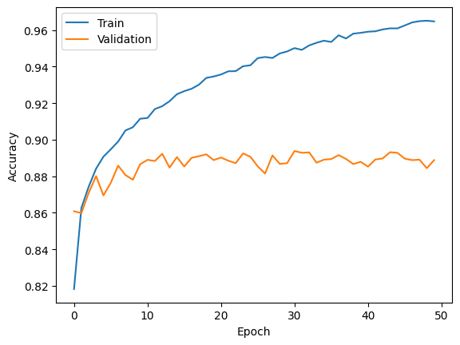
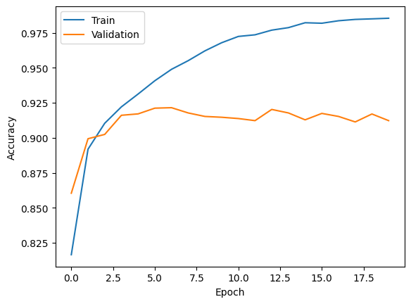

# Hello CNN 👋🧠

A hands-on Deep Learning project exploring the differences between **MLP (Multi-Layer Perceptron)** and **CNN (Convolutional Neural Network)** models across popular image classification datasets using TensorFlow and Keras.

The goal is to compare traditional fully connected neural networks with CNN-based architectures and understand how convolutional layers improve image classification performance.

## 📊 Model Accuracy Comparison

| Dataset | MLP (Machine Learning) 😭 | CNN + MLP (Deep Learning) 😍 |
|---|--------------------------:|-----------------------------:|
| MNIST |                       97% |                          99% |
| Fashion-MNIST |                       88% |                          91% |
| CIFAR-10 |                       43% |                          71% |
| CIFAR-100 |                       17% |                          25% |
---
Mnist :
<br>
<pre>
ML:                          DL:
</pre>
<br>


-------------------------------------
---
Fashion Mnist :
<br>
<pre>
ML:                          DL:
</pre>
<br>



-------------------------------------
---
CIFAR 10 :
<br>
<pre>
ML:                          DL:
</pre>
<br>


-------------------------------------
---
CIFAR 100 :
<br>
<pre>
ML:                          DL:
</pre>
<br>


## 📁 Project Structure

Each dataset has its own directory containing the Jupyter Notebook and the output files for accuracy and loss results.

```text
Hello-CNN/
├── MNIST/
│   ├── main.ipynb
│   └── output/
│       ├── DL_accuracy_loss.png
│       └── ML_accuracy_loss.png
├── Fashion-MNIST/
│   ├── main.ipynb
│   └── output/
│       ├── DL_accuracy_loss.png
│       └── ML_accuracy_loss.png
├── CIFAR-10/
│   ├── main.ipynb
│   └── output/
│       ├── DL_accuracy_loss.png
│       └── ML_accuracy_loss.png
├── CIFAR-100/
│   ├── main.ipynb
│   └── output/
│       ├── DL_accuracy_loss.png
│       └── ML_accuracy_loss.png
│── README.md
└── requirement.txt
```

## 🧠 Models

### 1. MLP — Machine Learning 😭

The MLP model uses fully connected (`Dense`) layers to classify images.

Architecture:

- Input layer
- Flatten layer
- Dense layer with 128 neurons and ReLU activation
- Dense layer with 64 neurons and ReLU activation
- Output layer with 10 neurons and Softmax activation

### 2. CNN + MLP — Deep Learning 😍

The CNN model extracts spatial features from images using convolutional and pooling layers before passing the extracted features to fully connected layers.

Architecture:

- Input layer
- Two `Conv2D` layers with 64 filters
- `MaxPooling2D`
- Two `Conv2D` layers with 128 filters
- `MaxPooling2D`
- One `Conv2D` layer with 256 filters
- `Flatten`
- Dense layer with 128 neurons and ReLU activation
- Output layer with 10 neurons and Softmax activation

## 🛠️ Technologies

- Python
- TensorFlow
- Keras
- Matplotlib
- Jupyter Notebook

## 📈 Training and Evaluation

For each dataset, the notebook follows these steps:

1. Load the dataset using TensorFlow/Keras.
2. Normalize image pixel values to the range `[0, 1]`.
3. Build and compile the MLP and CNN models.
4. Train the models using the training dataset.
5. Validate the models using a validation split.
6. Evaluate the trained models on the test dataset.
7. Plot training and validation accuracy.
8. Plot training and validation loss.
9. Save the resulting plots in the dataset's `output/` directory.

The models use the Adam optimizer, Sparse Categorical Crossentropy loss, and accuracy as the evaluation metric.

## 🚀 Future Plans

- [x] Implement an MLP for MNIST.
- [x] Implement a CNN for MNIST.
- [x] Compare MLP and CNN on Fashion-MNIST.
- [ ] Improve model accuracy through architecture and hyperparameter tuning.
- [x] Implement and evaluate CIFAR-10 models.
- [x] Implement and evaluate CIFAR-100 models.
- [x] Complete the accuracy comparison table.

## 🎯 Project Goal

Build a practical understanding of neural networks by experimenting with different architectures, comparing their results, and documenting the learning process.

**Hello CNN — learning Deep Learning one dataset at a time.**